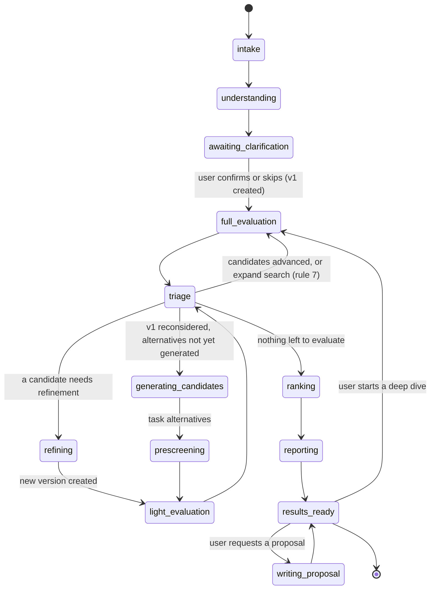
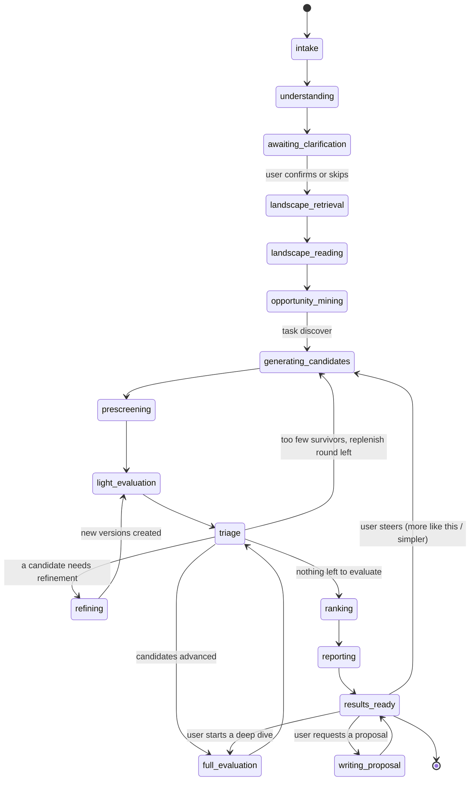
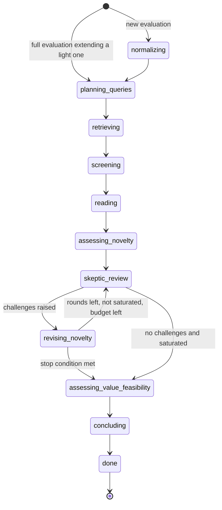
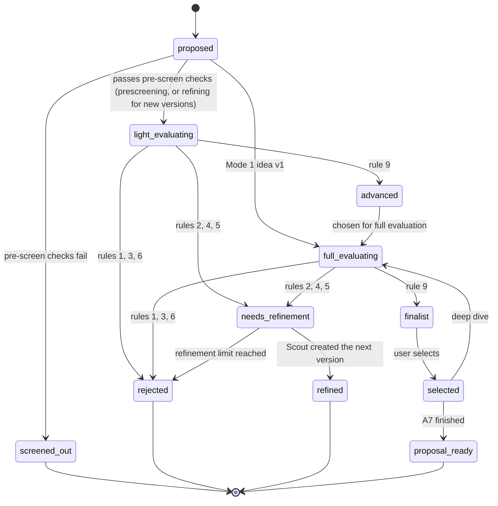

# 05: Workflows and Orchestration

The orchestrator (C1) is a **deterministic state machine** written in code. LLMs never decide the control flow. They return structured assessments, and code rules decide what happens next. That makes runs reproducible, testable and resumable after a crash.

## 1. Shared building block: candidate evaluation

Both workflows call the same evaluation routine on a candidate, at one of two depths.

| Step | Light evaluation (screening) | Full evaluation (finalists, Mode 1 idea) |
|---|---|---|
| 1. Normalize candidate (A1) | Yes | Yes |
| 2. Query plan (A1) | 8–10 queries | 15–20 queries |
| 3. Targeted retrieval (C2) | ~100 screened | ~300 screened + citation snowballing |
| 4. Read (A3) | Top ~12 (cached analyses reused) | Top ~30–40 + full text for the top ~10 open-access papers |
| 5. Novelty Investigator (A4) | Yes | Yes |
| 6. Skeptic loop (A5 ⇄ A4) | 1 round | Up to 3 rounds, stop at saturation |
| 7. Value & Feasibility (A6) | Full task | Full task |
| 8. Verify + verdicts (C4) | Yes | Yes |
| Output | Verdicts + reasons (enough for triage) | Verdicts + full evidence, ready for a research package |

Results are stored on the candidate. A candidate that passes light evaluation is **upgraded** to full evaluation. Upgrading reuses everything already gathered and only adds more search, reading and Skeptic rounds.

## 2. Workflow A: Evaluate My Research Idea

```text
INTAKE ──► CLARIFY (optional, human) ──► candidate v1 (origin: user)
   │
   ▼
FULL EVALUATION (section 1)
   │
   ▼
TRIAGE (rules, section 4)
   ├─ Pursue ───────────────────────────────────────────► REPORT
   ├─ Refine (fixable issue) ─► Scout: Refine ─► candidate v2 ─► re-evaluate affected
   │                                                    dimensions + quick novelty ─► TRIAGE
   └─ Reconsider ─► Scout: Alternatives (3–5, from this investigation's corpus)
                       ─► LIGHT EVALUATION each ─► best 1–2 ─► FULL EVALUATION ─► REPORT
REPORT ──► (user) PROPOSAL (A7) / export
```

**Step details:**

1. **Intake:** validate inputs, detect complexity/constraint conflicts (doc 02), create the investigation.
2. **Clarify:** A1 returns facets + questions. The UI waits for the user to confirm, edit or skip. When skipped, the stated assumptions are recorded.
3. **Full evaluation** of v1.
4. **Triage** by rules.
5. **Report.** Even when the user's idea fails, the report shows exactly why (closest works, facet matrix) and the best alternatives.

## 3. Workflow B: Find Me a Research Idea

```text
INTAKE ──► FIELD BRIEF (A1) ──► CLARIFY (optional, human)
   │
   ▼
LANDSCAPE RETRIEVAL (C2): recent papers (last ~3 years), surveys/reviews,
   highly cited recent work, latest preprints, per subtopic. ~300 screened.
   + SIGNALS (C3): GitHub, Hugging Face datasets, Hacker News, news (tier 3)
   │
   ▼
LANDSCAPE READING (A3): ~40–50 papers (cached analyses reused)
   │
   ▼
OPPORTUNITY MINING (code): landscape map, limitation clusters,
   contradiction pairs, method × problem matrix, dataset hints
   │
   ▼
GENERATE (Scout: Discover) ──► 8–12 candidates
   │
   ▼
PRE-SCREEN (code + A6 quick feasibility): grounding check, dedup,
   hard-constraint filter, diversity ──► keep up to 6
   │
   ▼
LIGHT EVALUATION (parallel, concurrency 2–3) ──► TRIAGE
   ├─ reject (reason recorded, shown to the user)
   ├─ refine ─► Scout: Refine ─► light re-evaluation (counts against limits)
   ├─ advance
   └─ too few advanced and regeneration budget left ─► Scout: Replenish ─► PRE-SCREEN
   │
   ▼
FULL EVALUATION of top ≤3 advanced candidates ──► TRIAGE ──► RANK
   │
   ▼
PRESENT: opportunity cards (ranked) + rejected candidates with reasons
   │
   ▼ (user selects)
PROPOSAL (A7) for the selected candidate  and/or  DEEP DIVE (Workflow A on it)
```

**Ranking finalists.** No single numeric score is shown. Finalists are ordered by rules:

1. Recommendation: Pursue before Refine.
2. Novelty category: Supported before Potential.
3. Feasibility: Feasible before Feasible with adjustments.
4. Significance level.

Ties are broken by evidence strength (number of verified supporting quotes). The UI shows the ordering reasons.

## 4. Triage rules (shared by both workflows)

Triage runs after each evaluation. The first rule that matches applies.

| # | Condition (from verdicts) | Action |
|---|---|---|
| 1 | A hard constraint is violated (feasibility blocking requirement that can't be simplified) | **Reject** ("infeasible under your constraints") |
| 2 | Novelty = *Previously investigated* **and** the closest work leaves a facet open | **Refine once** (differentiate on the open facet); otherwise **reject** |
| 3 | Novelty = *Previously investigated*, no open facet | **Reject** (Mode 1: trigger Alternatives) |
| 4 | Novelty = *Incremental variation* | **Refine once** to increase the contribution; if it's still incremental, reject (Beginner level: may be kept if it meets the meaningful-minimum standard, labelled as incremental) |
| 5 | Feasibility = *Not feasible* with suggested simplifications | **Refine** (simplify), then re-check feasibility **and** run a quick novelty check, because simplified ideas often collide with existing work |
| 6 | Significance = *Weak* | **Reject** (Mode 1: report with alternatives) |
| 7 | Novelty = *Insufficient evidence* | If budget allows, **expand search** once (more queries/sources); otherwise keep it, flagged "needs further investigation" |
| 8 | A Skeptic challenge refuted a key claim | Re-run the novelty assessment with the challenge, then re-apply triage |
| 9 | Otherwise | **Advance** (light → full) or **finalize** (full) |

Every triage decision is stored with its rule number and the evidence IDs behind it. That record is the "why" behind each card in the UI.

## 5. Candidate lifecycle

A candidate is proposed, pre-screened, evaluated light, advanced to a full evaluation, and ends as a finalist, rejected, screened out or refined. Each refinement creates a **new version** linked to its parent; the parent ends as `refined` and stays visible, so the user sees how an idea evolved and why.

The exact statuses and allowed transitions are defined in **§11.5**, which is authoritative.

## 6. Budgets, limits and stopping conditions

These are default values to tune with real runs. They're all configuration, not code.

| Limit | Mode 1 | Mode 2 |
|---|---|---|
| Papers screened (total) | 300 | 600 (landscape 300 + candidates) |
| Papers read (new analyses, not cached) | 40 | 120 |
| Candidates generated | 3–5 alternatives if needed | 8–12 (+ ≤1 replenish round of ≤6) |
| Light evaluations | ≤5 | ≤8 |
| Full evaluations | ≤3 (the idea + refinements/alternatives) | ≤3 |
| Skeptic rounds | 3 (full) / 1 (light) | same |
| Refinements per candidate | ≤2 | ≤2 (≤4 per investigation) |
| Scout tool calls per task | ≤8 | ≤8 |
| Skeptic searches per round | ≤6 | ≤6 |
| LLM cost cap | ~$5 | ~$12 |
| Wall-clock cap | ~15 min | ~30 min |

**Stopping conditions:**

- **Skeptic loop:** saturation (a round finds 0 new relevant papers), the round limit, or the budget runs out.
- **Mode 2 overall:** the requested number of finalists is reached, or the budget is exhausted, or candidate generation is exhausted (replenish limit used).
- **Budget exhaustion is never silent.** The run finishes with what it has. Verdicts degrade to "insufficient evidence" or "needs further investigation" where coverage is low, and the report says which budget stopped it.

Budgets are enforced in two places:

1. The orchestrator checks counters before each stage.
2. The LLM callback refuses calls once the cost cap is reached.

## 7. Human-in-the-loop points

| Point | What the user can do | Default if skipped |
|---|---|---|
| Clarify (both modes) | Answer questions; edit facets or the field brief | Proceed with the recorded assumptions |
| After the Mode 2 presentation | Select an opportunity; reject one; ask the Scout for more in a direction ("more like this", "simpler") | Nothing more happens until the user acts |
| Refinement suggestions | Accept a proposed refinement of their own idea (Mode 1) | Eureka shows the refinement as a suggestion; it doesn't change the user's idea itself |
| Proposal | Request generation; regenerate a section | — |

## 8. Progress events

Every stage transition emits an event: stage name, counts (screened/read/candidates), the current candidate, cost so far, and messages like "Skeptic round 2 found 1 new relevant paper". The frontend shows these live (doc 11, doc 12).

## 9. Resumability and failure handling

- After each stage, the orchestrator persists its state (stage, counters, candidate statuses). After a crash or redeploy, the investigation resumes from the last completed stage.
- Stage-level failure handling is described in doc 06 (sources), doc 07 (verification) and doc 08 (LLM errors). The orchestrator's rule: **a failing component degrades the result; it doesn't crash the investigation.** Where it matters, the failure is visible in the coverage report.

## 10. Mapping to ADK

| Concept | ADK building block |
|---|---|
| Orchestrator | Custom agent with the state machine in its run logic |
| A1, A3, A4, A6, A7 | LLM agents with an output schema |
| A2 Scout, A5 Skeptic | LLM agents with function tools |
| Skeptic ⇄ Novelty rounds | Loop agent (max iterations, early exit on saturation) |
| Per-paper reading, per-candidate light evaluation | Async fan-out with semaphores inside the custom agent |
| State | ADK session (IDs + stage) backed by Postgres; domain data in our tables |
| Logging / cost / budget | Before/after-model callbacks |

## 11. The formal state graph (authoritative)

Sections 2–5 explain the workflows in prose. This section defines them **exactly**. It's Eureka's equivalent of a LangGraph graph, implemented by our own orchestrator.

**There are three levels of state**, because in Mode 2 several candidates are evaluated in parallel and one "stage" can't describe all of them:

| Level | Stored in | Answers |
|---|---|---|
| **Investigation stage** | `Investigation.stage` | Where is the orchestrator in the workflow? |
| **Evaluation step** | `Evaluation.step` | Where is this one candidate's evaluation? |
| **Candidate status** | `Candidate.status` | What has happened to this idea? |

**The names below are exact.**

- They become the enum values in the code (`src/ai/workflows/states.py`, step 4) and the values stored in the database.
- The allowed transitions become a transition table in that same file. **Any transition not listed here is a bug:** the orchestrator raises an error instead of performing it, and a test checks that the code's table matches this section.
- Changing the graph means changing this section, the code and the test together.

### 11.1 Investigation stages

| Stage | Mode | Runs | What happens | Investigation status |
|---|---|---|---|---|
| `intake` | both | code | Validate inputs, detect complexity/constraint conflicts, take the constraints snapshot | running |
| `understanding` | both | **A1** Idea Analyst | Mode 1: the idea's facets. Mode 2: the field brief. Plus ≤3 clarifying questions → Intake | running |
| `awaiting_clarification` | both | **human** | The user confirms, edits or skips. Mode 1: Candidate v1 is created on confirmation | clarifying |
| `landscape_retrieval` | 2 | code (C2, C3) | Landscape searches per subtopic + tier-3 signals | running |
| `landscape_reading` | 2 | **A3** Paper Reader | Read ~40–50 landscape papers (cache reused) | running |
| `opportunity_mining` | 2 | code (miners) | Subtopics, limitation clusters, contradictions, combinations, dataset hints → OpportunityItems | running |
| `generating_candidates` | both | **A2** Scout | One Scout task: *discover* (Mode 2 start), *alternatives* (Mode 1 after a reconsider), *replenish* (Mode 2, too few survivors, or user steering) | running |
| `prescreening` | both | code + **A6** quick feasibility | Grounding check, dedup, hard-constraint filter, diversity → `screened_out` or `light_evaluating` | running |
| `light_evaluation` | both | evaluation sub-graph (§11.4), depth light | Every candidate in `light_evaluating`, in parallel (concurrency 2–3) | running |
| `refining` | both | **A2** Scout (task *refine*) + the pre-screen checks | One new version per candidate in `needs_refinement`. Each new version passes the same checks as `prescreening` (grounding, hard constraints) before it goes to light evaluation | running |
| `full_evaluation` | both | evaluation sub-graph, depth full | The Mode 1 idea (v1), plus advanced candidates (Mode 2: the best ≤3) | running |
| `triage` | both | code (rules §4) | Applies the triage rules to every evaluation just finished, then picks the next stage (§11.2–11.3) | running |
| `ranking` | both | code | Orders finalists by the rules in §3; marks the rest | running |
| `reporting` | both | code | Builds the report: verdicts, evidence, coverage, Skeptic log, rejected candidates with reasons | running |
| `results_ready` | both | **human** | Results are shown. User actions start new work (§11.6) | completed |
| `writing_proposal` | both | **A7** Proposal Designer | Research package for the selected candidate | running |

**Investigation status values:** `created` (before `intake`), `running`, `clarifying`, `completed`, `failed`, `cancelled`.

### 11.2 Workflow A: Evaluate My Research Idea



### 11.3 Workflow B: Find Me a Research Idea



**How `triage` picks the next stage (both workflows).** Triage first records a decision for every evaluation just finished (rules §4). Then the **first** matching line below decides the next stage:

| Priority | Condition | Next stage |
|---|---|---|
| 0 | A budget or the wall-clock limit is exhausted | `ranking` (finish with what exists; the report says which limit stopped it) |
| 1 | Some candidate is `needs_refinement` and its lineage has refinements left | `refining` |
| 2 | Mode 1: v1 was rejected (reconsider) and alternatives haven't been generated yet | `generating_candidates` (*alternatives*) |
| 3 | Mode 2: finalists + advanced < requested count, and a replenish round is left | `generating_candidates` (*replenish*) |
| 4 | Some candidate needs a (re)run of full evaluation: Mode 1 v1 with rule 7 (expand search, once), or `advanced` candidates (Mode 1: best ≤2; Mode 2: best ≤3, within the full-evaluation limit) | `full_evaluation` |
| 5 | Otherwise | `ranking` |

Candidates in `needs_refinement` whose lineage is out of refinements become `rejected` (rule recorded as "refinement limit reached"). `advanced` candidates that don't fit the full-evaluation limit keep the status `advanced` and are shown as "passed screening, not fully evaluated".

### 11.4 Evaluation steps (the sub-graph run inside `light_evaluation` and `full_evaluation`)



| Step | Runs | Light | Full |
|---|---|---|---|
| `normalizing` | **A1** | Facets for the candidate (skipped for Mode 1 v1, whose facets come from the Intake, and when extending a light evaluation) | same |
| `planning_queries` | **A1** | 8–10 queries | 15–20 queries |
| `retrieving` | code (C2) | ~100 screened, no snowballing | ~300 screened + citation snowballing |
| `screening` | code + LLM relevance | Top ~12 selected for reading | Top ~30–40 + full text for the top ~10 open-access papers |
| `reading` | **A3** | Cached analyses reused | same |
| `assessing_novelty` | **A4** | Facet matrix, claims | same |
| `skeptic_review` | **A5** | 1 round maximum | Up to 3 rounds; stop at saturation |
| `revising_novelty` | **A4** | Responds to challenges | same |
| `assessing_value_feasibility` | **A6** full task | Significance + feasibility | same |
| `concluding` | code (C4) | Freeze the coverage snapshot, then compute verdicts (in that order) | same |
| `done` | — | Evaluation complete; the investigation's `triage` handles it | same |

The evaluation's separate **status** (`running` / `done` / `partial` / `failed`) records *how* it ended. A failed step degrades the evaluation to `partial` instead of stopping the investigation. Example: all sources fail → novelty becomes "insufficient evidence".

### 11.5 Candidate statuses



| Status | Meaning | Set by |
|---|---|---|
| `proposed` | Created (by the user's idea or the Scout), not yet checked | orchestrator |
| `screened_out` | Failed pre-screen (ungrounded, breaks a hard constraint, duplicate). **Final** | orchestrator (pre-screen) |
| `light_evaluating` | In a light evaluation | orchestrator |
| `advanced` | Passed light evaluation; waiting for (or not chosen for) full evaluation | triage |
| `full_evaluating` | In a full evaluation | orchestrator |
| `needs_refinement` | Triage asked for a refinement | triage |
| `refined` | Superseded by its refined version (the child links to it). **Final** | orchestrator (after `refining`) |
| `finalist` | Passed full evaluation; ranked in the results | triage |
| `rejected` | Rejected by a triage rule or the refinement limit. **Final**, with the reason shown | triage |
| `selected` | The user chose it | user |
| `proposal_ready` | Its research package exists. **Final** | orchestrator (after A7) |

Rules 7 (expand search) and 8 (re-run novelty after a refuted claim) don't change the candidate's status. Rule 7 re-enters `full_evaluation` for the same candidate; rule 8 is handled inside the evaluation (`skeptic_review` ⇄ `revising_novelty`).

### 11.6 Transitions outside the normal flow

| Event | From | To |
|---|---|---|
| **Cancel** (user) | any stage | Finishes the current step, then status `cancelled`; the stage keeps its last value |
| **Mandatory stage fails** (`intake`, `understanding`, or every source failing in the first retrieval) | that stage | Status `failed`, with the error in the report |
| **Optional component fails** (one source, one paper, one agent call after retries) | any | No transition: the result degrades and the failure appears in the coverage snapshot |
| **Budget exhausted** | any stage after clarification | `ranking` → `reporting` → `results_ready` |
| **Crash / redeploy** | any | On restart: resume at the last stage whose outputs were committed (er-model §1.2) |
| **User requests a proposal** | `results_ready` | `writing_proposal` (candidate `finalist` → `selected` → `proposal_ready`) |
| **User starts a deep dive** | `results_ready` | `full_evaluation` for that candidate (`selected` → `full_evaluating`), then the normal flow from `triage` |
| **User steers** (Mode 2: more like this / simpler / exclude) | `results_ready` | `generating_candidates` (task *replenish*, with the user's direction) |

### 11.7 How the code enforces this graph (step 4)

- **`src/ai/workflows/states.py`:** three enums with the exact names above, plus three transition tables (investigation stages per mode, evaluation steps, candidate statuses).
- **One function per kind of state change.** It checks the transition table, writes the new value **together with the stage's outputs in one transaction** (er-model §1.2), and emits a ProgressEvent. Candidate status changes also check the current value, so two parallel workers can't move the same candidate.
- **Tests:** every listed transition is allowed; a sample of unlisted ones is rejected; and a test compares the code's tables with this section's transition lists.
