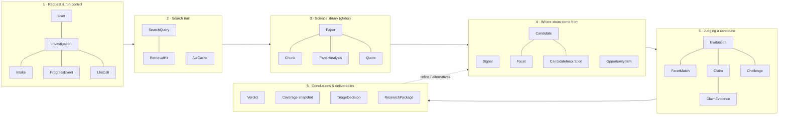
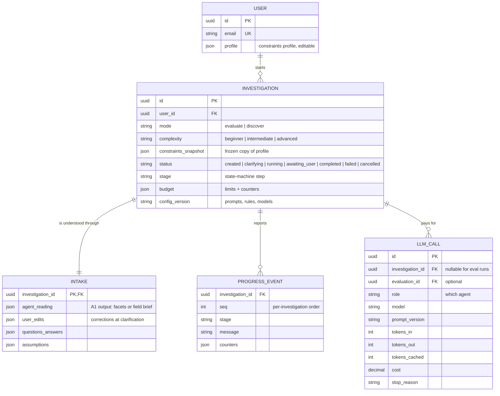
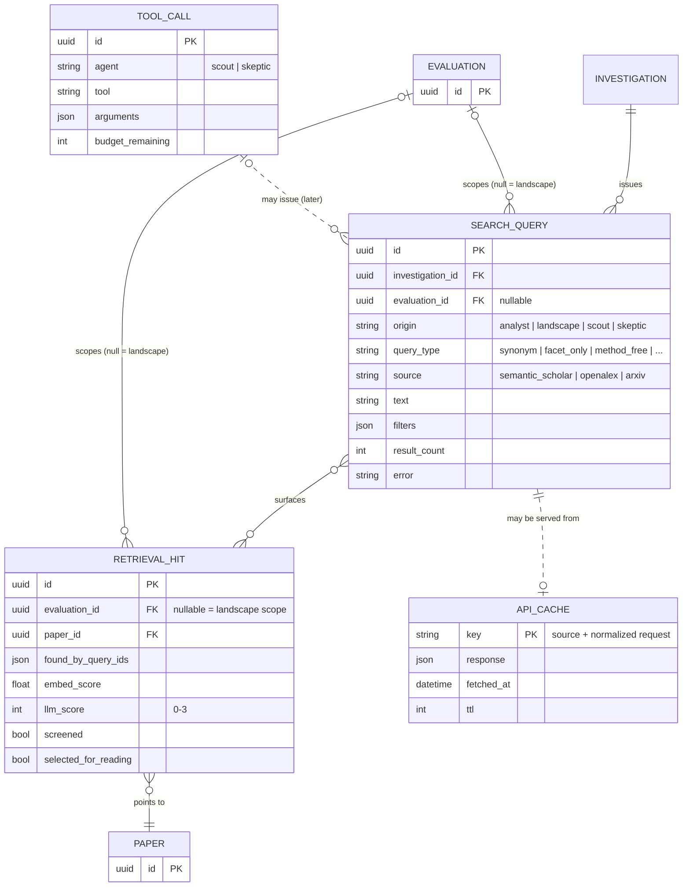
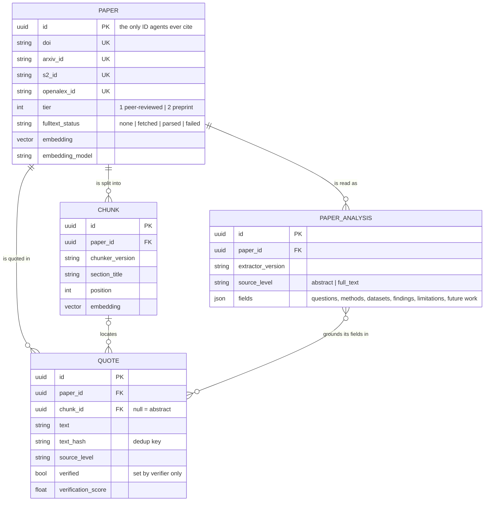
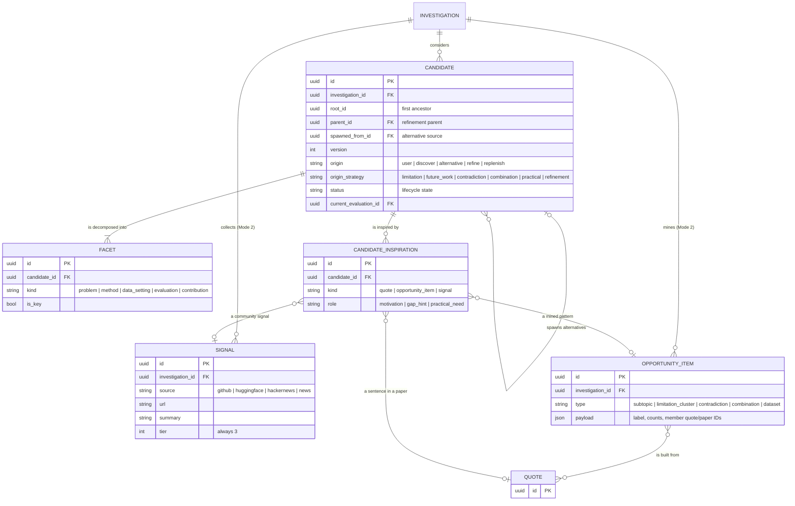
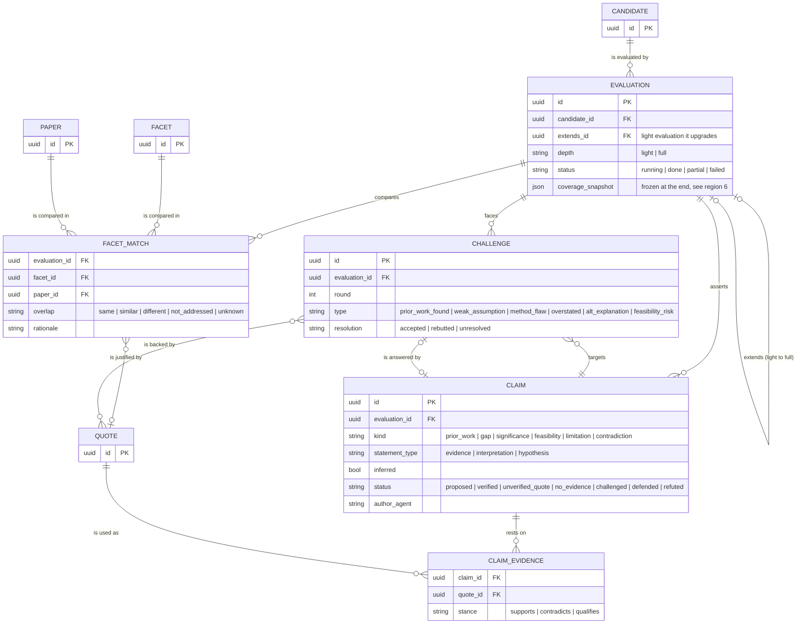
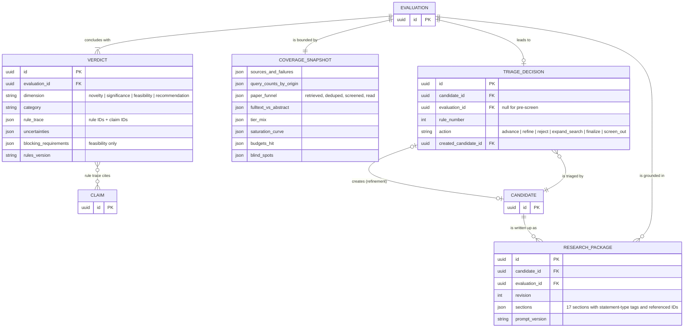

# Eureka ER Model: the pipeline told through its data

The architecture documents describe Eureka as **agents and steps**. This document describes the same system as **things and relationships**:

- what exists,
- what depends on what,
- what may change and what must never change,
- which rules hold the data together.

Many of these rules are only implicit in the other documents. If you understand this model, you understand what Eureka can and can't claim, and why.

> **Companion documents:** doc 10 (Data model) explains every field in detail. This document is about **structure, dependencies and invariants**. It uses the corrected entity set from the audit at the end (section 9), which has been applied to doc 10 (version 2).
>
> **Diagrams** use Mermaid. They render on GitHub and in VS Code (Markdown preview with Mermaid support). Attributes in the diagrams are the *structural* ones (keys, links, states); the full field lists are in doc 10.

---

## 0. The picture in one minute

Eureka's data falls into **six regions**. Each one corresponds to a part of the pipeline:

### 0.1 Three spines run through the whole model

Almost every question about Eureka's behavior can be answered by following one of these spines:

| Spine | Path | What it answers |
|---|---|---|
| **Ownership spine** | User → Investigation → Candidate → Evaluation → (Claims, Challenges, Verdicts) | *Whose is this, and what gets deleted together?* |
| **Evidence spine** | Verdict → Claim → ClaimEvidence → Quote → Chunk/abstract → Paper | *Why does Eureka believe this, and where exactly is it written?* |
| **Lineage spine** | Candidate → parent Candidate → … → root (user idea or Scout discovery) | *How did this idea evolve, and why?* |

### 0.2 One boundary matters more than any other: global vs scoped

| Global (shared by every investigation) | Scoped (owned by one investigation) |
|---|---|
| Paper, Chunk, PaperAnalysis, Quote, ApiCache | Everything else |

**What is true about a paper** (its text, its metadata, what it states) is global. It's stored once and reused, which is why Mode 2 is affordable.

**What Eureka thinks about a paper in relation to an idea** (relevance, facet matches, claims) is scoped. It depends on the candidate, and it is deleted with the investigation.

A useful test when adding any new field: *"Would this value be the same for every user and every idea?"* If yes, it belongs in the global library. If no, it's scoped.

### 0.3 Notation

Cardinality symbols in the diagrams:

| Symbol | Meaning |
|---|---|
| `\|\|` | exactly one |
| `o\|` | zero or one |
| `\|{` | one or more |
| `o{` | zero or more |

A dotted line means a logical link that isn't a strict foreign key. "Stub" entities (drawn again in a later section) belong to another section; they are repeated only to show the connection.

---

## 1. Request & run control

*Who asked what, under which constraints, and is the run healthy and within budget?*

This region is the **control plane** of an investigation. It doesn't contain any science. It records the request, Eureka's structured understanding of it, the progress of the run, and every unit of money spent.

### 1.1 Relationships and why they have that shape

- **User 1 → many Investigations.** Each request is a separate run. Results are never merged across runs, so every run stays reproducible.
- **Investigation 1 → 1 Intake.** Every run starts by turning free text into structure. The Intake keeps A1's original reading *and* the user's edits side by side. That way we can tell "what Eureka understood" from "what the user corrected", which is useful for improving A1.
- **Investigation 1 → many ProgressEvents.** Append-only. The per-investigation sequence number lets a reconnecting browser ask "everything after event 57" (server-sent events replay).
- **Investigation 1 → many LlmCalls.** Every model call is a billable row. `evaluation_id` is optional, so cost can be broken down per candidate ("candidate 3 cost $0.90").

### 1.2 Dependencies and invariants

1. **The constraints are a snapshot, not a reference.** The Investigation copies the profile at start. If the user later changes "T1" to "T2", old verdicts still read "not feasible on T1", which is correct for that run. A reference would silently rewrite history.
2. **Status vs stage.**
   - *Status* is coarse and user-facing.
   - *Stage* is the exact state-machine position.
   - **A stage counts as completed only when all of its output rows are committed in the same transaction as the stage update.** That is the unit of crash recovery: after a restart, the orchestrator re-runs the first uncommitted stage, and nothing is half-written.
3. **Budgets need reservation, not check-then-spend.** In Mode 2, several candidates are evaluated in parallel and all draw from one budget. If two workers both check "$0.40 left" and then both spend $0.30, the cap is broken. The orchestrator *reserves* an estimated cost (an atomic decrement) before a stage and settles the difference afterwards.
4. **Cost is stored twice, on purpose.**
   - LlmCall rows are the truth.
   - Investigation.budget holds a running total, so the budget check doesn't sum thousands of rows before every call.
   - A periodic reconciliation compares the two.
5. **The Intake shape depends on the mode.** In Mode 1 it holds the idea's facets; in Mode 2, the field brief. In Mode 1, confirming the Intake also creates **Candidate v1** (region 4). That's the hand-off point where a user's idea becomes a candidate like any other.
6. **The config version pins behavior.** Prompt, rule and model versions are recorded when the run starts. A later prompt change never changes how a finished investigation is explained.

### 1.3 Questions this region answers

"What exactly did the user ask?" · "What did Eureka assume?" · "Where is the run now?" · "How much has it cost, per agent and per candidate?" · "Which configuration produced this result?"

---

## 2. Search trail

*What did Eureka search, where, why, and what came back?*

This region is the **audit trail of looking**. Its purpose goes beyond logging: Eureka's honesty about absence ("we found nothing matching") is only as good as its record of where it looked. The coverage snapshot (region 6) is computed from this region.

### 2.1 Relationships and why they have that shape

- **SearchQuery has a scope:** a specific Evaluation, or none (= the landscape/intake phase). In Mode 2, the same investigation runs a landscape search *and* a separate targeted search per candidate. Without the scope, "how hard did we look for candidate 3?" couldn't be answered.
- **RetrievalHit is a paper *within a scope*, not within an investigation.** The same paper can be highly relevant to candidate 3 and irrelevant to candidate 5. Relevance scores therefore belong to the (evaluation, paper) pair. *(This is one of the corrections in the audit, section 9.)*
- **SearchQuery many ↔ many RetrievalHit.** One query finds many papers, and one paper is often found by several queries. `found_by_query_ids` records that, which lets us measure *which kinds of queries* find the important papers (e.g. "the Skeptic's method-free queries found the closest work").
- **ApiCache is a dotted link.** It sits below the source adapters, keyed by the normalized request. Reproducibility doesn't depend on it, because the Paper table is the truth; the cache only saves time and rate limits.
- **ToolCall (later)** records the Skeptic's and Scout's own tool use. In the MVP, their searches already appear as SearchQuery rows with `origin = skeptic | scout`, which is enough for coverage.

### 2.2 Dependencies and invariants

1. **Every search leaves a row, including failed ones.** A query that hit a rate limit is stored with its error. The coverage snapshot then reports "arXiv failed twice", and the verdict rules can downgrade.
2. **Query types are recorded** (synonym, facet-only, method-free, older terminology). The code check that enforces A1's query quotas (doc 04) reads them, and so does the evaluation of whether query diversity is worth it.
3. **Papers are created through get-or-create with dedup** (region 3). Two parallel evaluations can find the same paper at the same moment; unique constraints on external IDs plus retry-on-conflict make sure only one Paper row exists.
4. **Light → full upgrades reuse hits.** A full evaluation that extends a light one (region 5) sees the light evaluation's RetrievalHits as already screened, so they're never paid for twice.
5. **The cache is not truth.** If a cached response is stale, the worst case is missing a very new paper. That's why the cache date appears in the coverage blind spots ("papers after <date> may be missing").

### 2.3 Questions this region answers

"Which sources and queries were used for candidate 3?" · "Who found the closest paper: the analyst or the Skeptic?" · "Which sources failed?" · "How many papers were screened vs read?"

---

## 3. The science library (global)

*What do papers actually say, and exactly where do they say it?*

This is Eureka's **shared memory of the literature**. Nothing here is an opinion about an idea. It holds metadata, text, an idea-agnostic structured reading of each paper, and exact quotes. It's the only region allowed to be the *source* of evidence.

### 3.1 Relationships and why they have that shape

- **Paper 1 → many Chunks.** Only papers with parsed open-access full text have chunks. Abstract-only papers have none, and their quotes point to the abstract (`chunk_id` empty).
- **Paper 1 → many PaperAnalyses.** There's one analysis per **(extractor version, source level)**, not just one per paper. Two reasons:
  - When the Paper Reader prompt improves, new analyses are created instead of mixing formats.
  - When full text becomes available later, a full-text analysis supersedes the abstract-level one without destroying it.
- **Paper 1 → many Quotes; Chunk 0..1 → many Quotes.** A quote always belongs to a paper and optionally to a precise chunk. That's what lets the UI show "page context" and the badges "full text" vs "abstract".
- **PaperAnalysis ↔ Quotes.** Every limitation, future-work statement and finding in an analysis is anchored by a quote. That's what makes Mode 2's mined opportunities (region 4) traceable back to real sentences.

### 3.2 Dependencies and invariants

1. **The paper's internal ID is the citation currency.** LLMs never write titles, authors or DOIs. References in every output are rendered from this table. That's the structural guarantee against invented papers.
2. **Preprints and published versions are one work.** An arXiv preprint and its later conference version would otherwise appear as two papers and could be double-counted as "two independent works". The dedup step merges them into **one Paper with both IDs**, with tier = the best available (1 if a peer-reviewed version exists).
3. **Chunks are immutable.** If the chunker changes, a *new set* of chunks is created (new `chunker_version`), and old quotes keep pointing at the old chunks. Rewriting chunks in place would silently break existing evidence links.
4. **Quotes are facts about text, so they're global and deduplicated** on (paper, chunk, normalized text hash). Verification happens once, and every investigation that uses the same quote benefits.
5. **Only the verifier can set `verified`.** An agent can *propose* a quote. Code checks it against the stored abstract/chunk and records the score. Unverified quotes stay visible for debugging but never count in verdicts.
6. **Analyses are single-flight.** If two investigations need the same paper analysed at the same moment, only one Paper Reader call runs and the other waits for its result. Without that, Mode 2 runs would pay twice for popular papers.
7. **Vectors carry their model.** Similarity is computed only between vectors from the same `embedding_model`. Changing the embedding model means re-embedding, never mixing.

### 3.3 Questions this region answers

"Which papers do we know?" · "Is this quote really in the paper, and where?" · "Did we read the full text or only the abstract?" · "What limitations does this paper admit?"

---

## 4. Where ideas come from

*What can be researched, what inspired each idea, and how did ideas evolve?*

This region is where **candidates are born**. In Mode 1 there's one root candidate (the user's idea). In Mode 2 there are many, created by the Scout from mined literature patterns (and, as weaker motivation, community signals). Every candidate carries its **lineage** and its **inspiration**.

### 4.1 Relationships and why they have that shape

- **OpportunityItem many ↔ many Quote.** A limitation cluster *is* a set of quoted limitation sentences from several papers. A contradiction pair *is* two quoted findings. Mining results are therefore always reducible to text in the library, never free-floating summaries.
- **Two different self-links on Candidate:**
  - **`parent_id`** (refinement): v2 *is* v1, changed to fix a stated problem. Refinement limits are counted along this chain.
  - **`spawned_from_id`** (alternative): a *new* idea suggested because another one failed (Mode 1 alternatives). It starts its own chain (version 1) and has its own refinement budget.

  Mixing these up would make lineage misleading and break the loop limits.
- **`root_id`** is stored on every version, so "all versions of this idea" and "refinements used so far" are single lookups.
- **Candidate 1 → 1..many Facets.** A candidate can't be evaluated without facets, because novelty is judged facet by facet.
- **CandidateInspiration** points to *exactly one* of: a quote, an opportunity item, or a signal. That makes the Scout's grounding rule checkable by code: *at least two inspirations must resolve to verified quotes from tier-1/2 papers.* A Mode 1 user idea has no inspirations (it is the user's own), which is why the relationship is zero-or-more.

### 4.2 Dependencies and invariants

1. **Mining depends on reading.** OpportunityItems can only be created after the landscape papers have PaperAnalyses (region 3), because clusters are built from extracted limitations and findings. The orchestrator's landscape-reading stage must be committed first.
2. **Evaluated versions are frozen.** Once a candidate version has an Evaluation, its title, question and facets never change. Any change creates a new version, with new facets, linked through `parent_id`. Otherwise an old verdict would describe an idea that no longer exists.
3. **Signals can motivate but never ground.** Signals connect to candidates only through CandidateInspiration, and are never connected to claims (region 5). "Signal-only" isn't a stored flag; it's *derived* ("no inspiration resolves to a tier-1/2 quote"), so it can never get out of sync.
4. **Status transitions are guarded.** Candidate status changes only along the lifecycle in doc 05, and only if the current status matches what the orchestrator expects (e.g. "light_evaluating → needs_refinement"). This prevents two parallel workers from both moving the same candidate.
5. **`current_evaluation_id`** points to the evaluation the UI should show: the latest *completed* one, preferring full over light. Without that pointer, every screen would re-implement "which result is the current one?".
6. **Hard-constraint filtering happens here, before money is spent.** Candidates that violate hard constraints are set to `screened_out` before any evaluation exists, and the reason is recorded as a TriageDecision (region 6).

### 4.3 Questions this region answers

"Where did this idea come from?" · "Which papers' limitations inspired it?" · "Is it grounded in literature or only in community signals?" · "How did v3 differ from v1, and why?"

---

## 5. Judging a candidate

*Which existing work overlaps this idea, what does Eureka claim, and did those claims survive attack?*

This is the **reasoning core**. An Evaluation collects the comparison with prior work (facet matches), the statements Eureka makes (claims), the evidence for and against them, and the Skeptic's challenges. Agents write here, and code rules (region 6) read from it.

### 5.1 Relationships and why they have that shape

- **Candidate 1 → many Evaluations.** A candidate can be evaluated light, then full, or re-checked after a stage failure. Each pass is kept separately, because its depth determines what it is allowed to conclude.
- **Evaluation `extends` Evaluation.** A full evaluation that upgrades a light one inherits its retrieval hits (region 2) and starts from its claims. The link makes that reuse explicit and auditable.
- **FacetMatch = (Evaluation × Facet × Paper).** This three-way relationship *is* the prior-work matrix shown in the UI. It references a quote, because a "same" label without a verified quote doesn't count.
- **Claim many ↔ many Quote, through ClaimEvidence with a stance.** One quote can support one claim and qualify another; one claim can have supporting and contradicting evidence at the same time. The stance is what lets the report show both sides.
- **Challenge → Claim, twice.**
  - `targets`: the claim under attack.
  - `is answered by`: the rebuttal claim written by the Novelty Investigator.

  The debate is therefore *data*: you can follow claim → challenge → rebuttal → its evidence.

### 5.2 Dependencies and invariants

1. **Facet and evaluation must belong to the same candidate version.** A FacetMatch can't pair candidate v2's evaluation with a facet of v1. Because evaluated versions are frozen (region 4), this check is simple and permanent.
2. **Claims follow a strict order:** proposed (by an agent) → verified / unverified quote / no evidence (by the verifier) → challenged (by the Skeptic) → defended or refuted (by resolution rules). **Agents write the text; only code moves the status.** Claim text is never edited; a revised position is a *new* claim.
3. **Evidence can only be a Quote, and quotes only come from the science library.** Signals live in a different table and have no path into ClaimEvidence. So "community signals are never evidence" holds **by structure**, not just by a prompt instruction.
4. **New papers found by the Skeptic flow back into the search trail.** Each challenge round creates SearchQuery rows (origin skeptic) and RetrievalHits in *this evaluation's* scope. The Novelty Investigator's revision then sees them. This is the dependency that makes the self-critique loop real rather than rhetorical.
5. **Saturation is measured from data, not asserted.** "New relevant papers in round N" = RetrievalHits in this scope whose first finder query is from round N and whose LLM relevance score is ≥2. The Skeptic can't just *declare* it's done.
6. **Rounds are append-only.** Challenges from earlier rounds are never deleted, even when resolved. The Skeptic log shows the full argument history.

### 5.3 Questions this region answers

"Which paper covers which part of the idea?" · "What exactly does Eureka claim, and which claims are inferred?" · "What did the Skeptic object to, and how was each objection resolved?"

---

## 6. Conclusions & deliverables

*What did Eureka conclude, how thorough was it, what happened next, and what does the user take away?*

This region turns structured reasoning into **decisions**: verdicts computed by rules, a frozen record of search thoroughness, the orchestrator's next action, and the final research package.

### 6.1 Relationships and why they have that shape

- **Evaluation 1 → 1..many Verdicts.** One per dimension: novelty, significance, feasibility, and the recommendation computed from those three. It's "one or more" because a quick feasibility pre-screen produces a single verdict.
- **Verdict ↔ Claims (rule trace).** A verdict is not text; it's a category plus *the rules that fired and the claims they used*. The evidence spine starts here.
- **Coverage snapshot is 1:1 with Evaluation**, stored *inside* the Evaluation (that's why it has no keys in the diagram). It's computed from regions 2 and 5 when the evaluation ends, then **frozen**. Recomputing it later from live tables would change with new searches and break reproducibility.
- **TriageDecision links forward and backward.** Backward: which candidate and evaluation were judged. Forward: which new candidate was created (for refinement). This closes the loop in the pipeline diagram (region 6 → region 4) and lets the UI draw the "refined from … because …" timeline.
- **ResearchPackage → one specific Evaluation.** A package is grounded in exactly one (full) evaluation's evidence. If the candidate is re-evaluated, an older package still points to the evidence it was written from. Regenerating a section creates a new revision.

### 6.2 Dependencies and invariants

1. **Verdicts are computed, never written by an LLM.** The Verdict engine reads facet matches, verified claims, challenge resolutions and the coverage snapshot, and applies the versioned rule tables (doc 07). The Novelty Investigator's "proposed category" is advisory input only.
2. **Verdicts depend on coverage, so coverage is frozen first.** Order of operations at the end of an evaluation:
   1. Freeze the coverage snapshot.
   2. Compute the novelty, significance and feasibility verdicts.
   3. Compute the recommendation.
   4. Run triage.

   Reversing the order would let a verdict depend on numbers that change afterwards.
3. **Depth caps conclusions.** A light evaluation can't produce "Supported opportunity". The rule engine checks `depth` before applying the strongest category.
4. **Every pre-screen rejection is a TriageDecision too** (with no evaluation, action `screen_out`). Rejections are never silent, even the cheap ones.
5. **Triage creates work, within limits.** A `refine` decision creates a new Candidate (region 4). The orchestrator checks the refinement count along `root_id` and the investigation budget *before* writing the decision. Loop limits are enforced at the point where loops are created.
6. **Packages reference IDs, never text citations.** Section contents carry claim IDs and paper IDs. The backend renders references from the science library at display/export time, after checking that every ID exists.

### 6.3 Questions this region answers

"What's the verdict, and which rules and claims produced it?" · "How thorough was the search behind it?" · "Why was this candidate rejected or refined?" · "What did the user receive, based on which evidence?"

---

## 7. Cross-cutting rules

### 7.1 Ownership and deletion

| When this is deleted… | …these go with it | …these stay |
|---|---|---|
| User | Their investigations (and everything scoped below them), profile | Global library |
| Investigation | Intake, events, LlmCalls (or anonymized), queries, hits, signals, opportunity items, candidates and everything below | Papers, chunks, analyses, quotes (shared knowledge) |
| Candidate version | Never deleted while its investigation exists | — |
| Paper | Never deleted (other investigations may depend on it) | — |

### 7.2 What may change, and what never changes

| Mutable | Append-only | Immutable after creation |
|---|---|---|
| Investigation status, stage, budget counters | ProgressEvent, LlmCall, SearchQuery, TriageDecision, Challenge | Quote text, Chunk, PaperAnalysis, evaluated Candidate versions + their Facets |
| Candidate status, current evaluation pointer | ResearchPackage revisions | Verdicts and coverage snapshots (once an evaluation completes) |
| Claim status (by code only) | | Claim text |
| Intake (only before the run starts) | | |
| User profile (doesn't affect past runs: snapshot) | | |

The rule behind this table: **anything that an explanation points to must never change under it.** Explanations point to quotes, claims, verdicts and candidate versions, so those are frozen. Progress and status are mutable because nothing explains itself by pointing at them.

### 7.3 Five version clocks

Behavior in Eureka changes along five independent axes. Each is recorded where it matters:

| Clock | Recorded on | When it changes |
|---|---|---|
| Prompt version | LlmCall, PaperAnalysis (`extractor_version`), ResearchPackage | New analyses/outputs are created; old ones stay valid for old runs |
| Rule-table version | Verdict | New evaluations use new rules; old verdicts keep their rule trace |
| Embedding model | Paper, Chunk | Re-embed; never compare across models |
| Chunker version | Chunk | New chunk set; old quotes keep pointing to old chunks |
| Model configuration | LlmCall, Investigation config version | Cost and quality comparisons per configuration |

### 7.4 Concurrency hot spots

| Hot spot | Risk | Rule |
|---|---|---|
| Creating papers | Two workers create the same paper | Unique external IDs + get-or-create with retry |
| Analysing papers | Paying twice for the same analysis | Single-flight per (paper, extractor version, source level) |
| Budgets | Parallel workers overspend | Reserve before spending, settle after |
| Candidate status | Two workers move the same candidate | Transition only if the current status matches the expected one |
| Progress events | Out-of-order replay | Per-investigation sequence numbers |

### 7.5 Stored vs derived

| Stored (and why) | Derived (and why not stored) |
|---|---|
| Coverage snapshot: must be frozen for reproducibility | "Signal-only" candidate: computed from inspirations, can't drift |
| Investigation cost total: fast budget checks (reconciled with LlmCall) | Papers used by a candidate: computed from FacetMatch/ClaimEvidence |
| Candidate `root_id`: fast lineage and limit checks | Grounding count: computed from inspirations + quote verification |
| Current evaluation pointer: one definition of "current result" | Saturation per round: computed from hits + queries |

---

## 8. Following one explanation end to end

**User question:** *"Why does Eureka say my idea is only an incremental variation?"*

| Step | Entity | What the user sees |
|---|---|---|
| 1 | **Verdict** (novelty = Incremental variation, rules v2) | "Very close to existing work" + rule trace N2 |
| 2 | **Claims** cited by the trace | "Paper p_9001 applies the same method to the same task; the only difference is the language" (statement type: evidence) |
| 3 | **ClaimEvidence → Quotes** | The exact sentences, with "full text" badges |
| 4 | **Chunk → Paper** | Section "4 Experiments" of the 2025 paper, with its DOI link (rendered from the Paper record) |
| 5 | **FacetMatch row** | Problem: same · Method: same · Data/setting: similar (different language) · Evaluation: same |
| 6 | **Challenge** (round 1, prior work found, accepted) | It was the Skeptic who found p_9001, using a method-free query |
| 7 | **SearchQuery** (origin skeptic, type method_free) | The exact query and source |
| 8 | **Coverage snapshot** | 280 screened, 31 read, saturation 3 → 1 → 0, no source failures |
| 9 | **TriageDecision** (rule 4, refine) → **Candidate v2** | "Refined to target sub-1B models in Armenian, which p_9001 didn't test" |

Every step is a lookup along the evidence spine or the lineage spine. Nothing in the explanation is generated after the fact.

---

## 9. Audit: are all the entities in doc 10 needed?

Each entity in doc 10 was checked against one question: *does a pipeline step, a rule or a UI view actually need it as its own stored entity?*

**Result:** 29 entities in doc 10 → **25 tables in the MVP**, plus 2 deferred to later.

### 9.1 Kept as they are (they all carry real responsibilities)

Investigation, Paper, Chunk, PaperAnalysis, Quote, SearchQuery, Signal, Candidate, Facet, Evaluation, FacetMatch, Claim, ClaimEvidence, Challenge, Verdict, TriageDecision, ResearchPackage, ProgressEvent, LlmCall, ApiCache.

### 9.2 Merged (same information, fewer tables)

| Doc 10 | Change | Why |
|---|---|---|
| ConstraintsProfile | → a `profile` field on **User** | One profile per user; investigations take a snapshot anyway |
| StructuredIdea + FieldBrief | → one **Intake** entity with mode-specific content | Both are "A1's reading + the user's corrections". In Mode 1 the title, question and facets live on Candidate v1, so StructuredIdea duplicated them |
| CoverageReport | → a frozen **coverage snapshot inside Evaluation** | Always exactly one per evaluation and never queried on its own |

### 9.3 Deferred (not needed for the MVP)

| Doc 10 | Change | Why |
|---|---|---|
| ConversationMessage | Later, with the optional Ask panel | Clarification answers live in Intake; steering actions are recorded as TriageDecision / Scout tasks |
| ToolCall | Later | In the MVP, agent searches are already SearchQuery rows (origin scout/skeptic), and tool budgets are counters on the investigation |

### 9.4 Corrected (real modelling problems found)

| Doc 10 | Problem | Correction |
|---|---|---|
| InvestigationPaper | Stored relevance per *investigation*, but in Mode 2 relevance depends on the *candidate* | Renamed **RetrievalHit**, scoped to an evaluation (or to the landscape phase) |
| SearchQuery (no scope) | Couldn't answer "how hard did we search for candidate 3?" | Added an optional **evaluation scope** |
| InvestigationPaper "used by candidates" | Stored a fact that can be derived (and could drift) | Removed; derived from FacetMatch / ClaimEvidence |
| Candidate "signal-only flag" | Same issue | Removed; derived from inspirations |
| Candidate lineage | One parent link mixed refinements with alternatives | Separate **parent** (refinement) and **spawned-from** (alternative) links, plus `root_id` |
| PaperAnalysis key | One per (paper, extractor version) couldn't hold an abstract-level and a full-text analysis together | Key is (paper, extractor version, **source level**) |

### 9.5 Added (implicit in doc 10, now explicit)

| New | Why |
|---|---|
| **CandidateInspiration** | Doc 10 mentioned "inspiration links" inside a field. A link table makes the Scout's grounding rule (≥2 verified tier-1/2 quotes) checkable by code |
| `chunker_version`, `text_hash`, `extends_id`, `current_evaluation_id`, `seq`, `created_candidate_id` | Small structural fields required by the invariants above (immutability, dedup, reuse, replay, loop tracing) |

**Status:** applied. Doc 10 (version 2) now describes exactly this corrected model, field by field.
